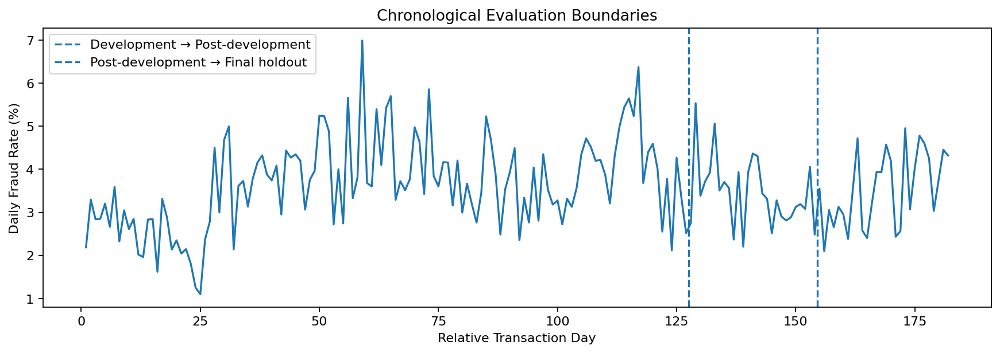
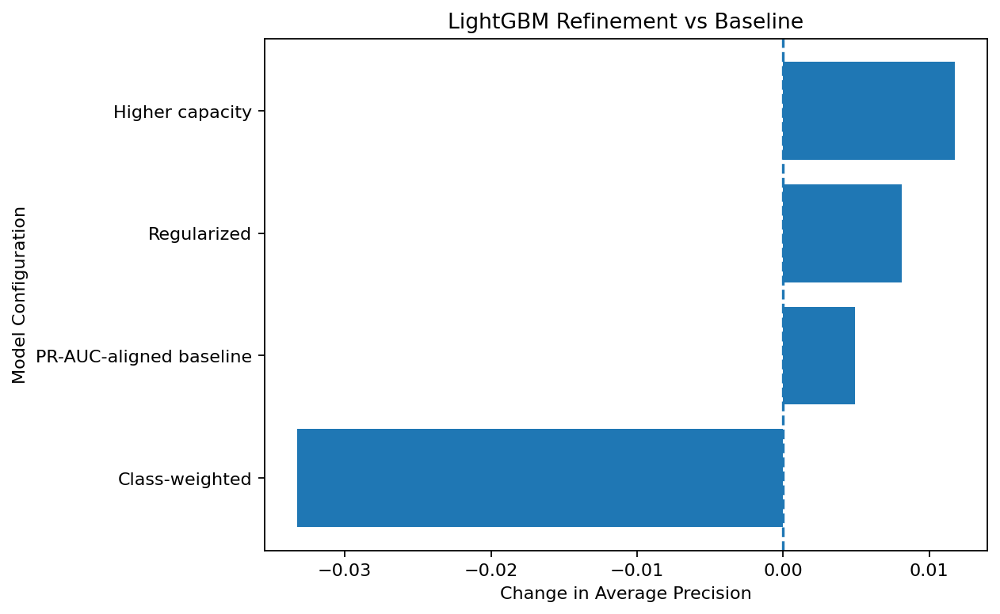
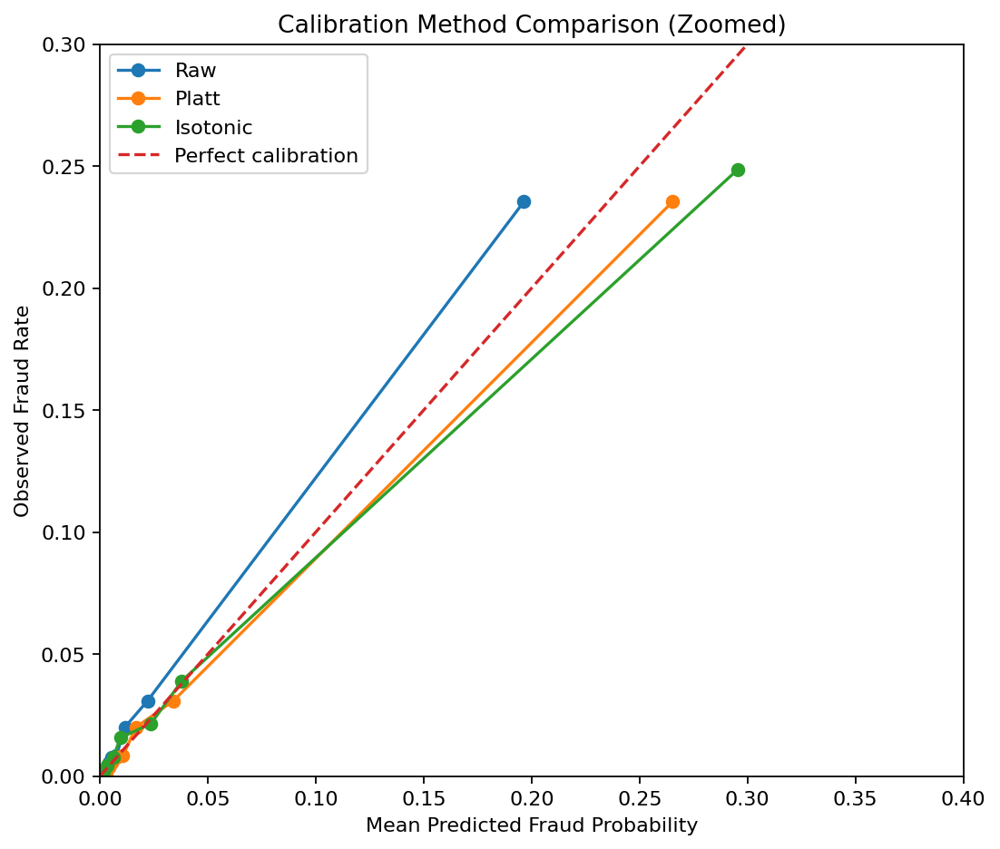
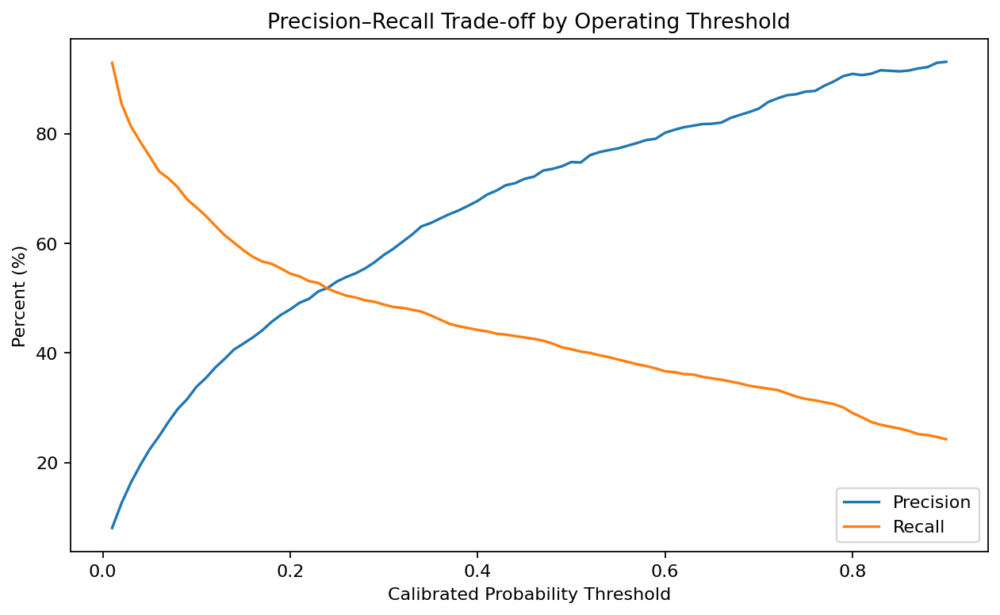
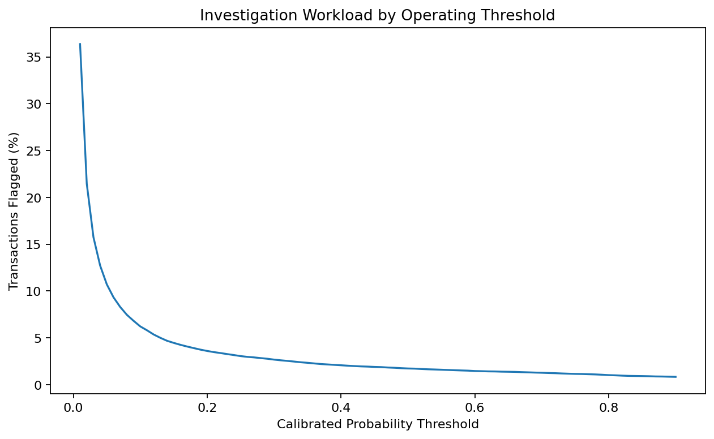
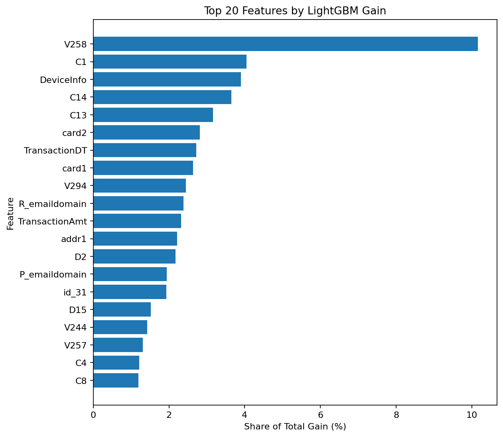
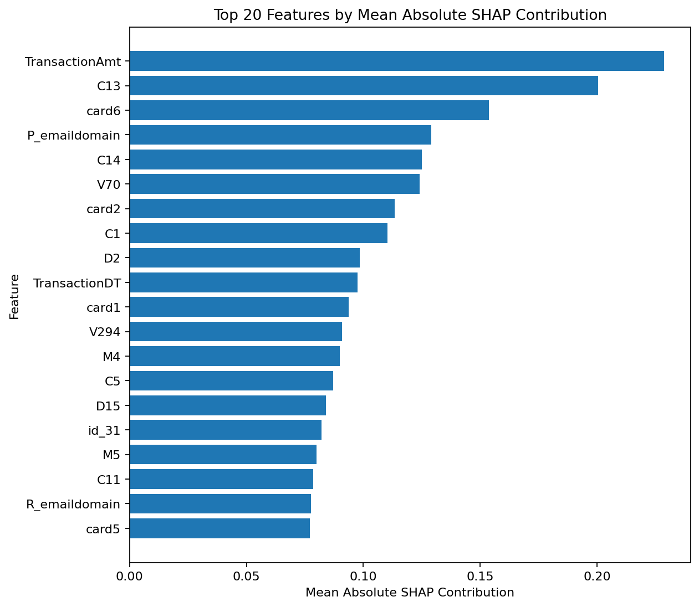
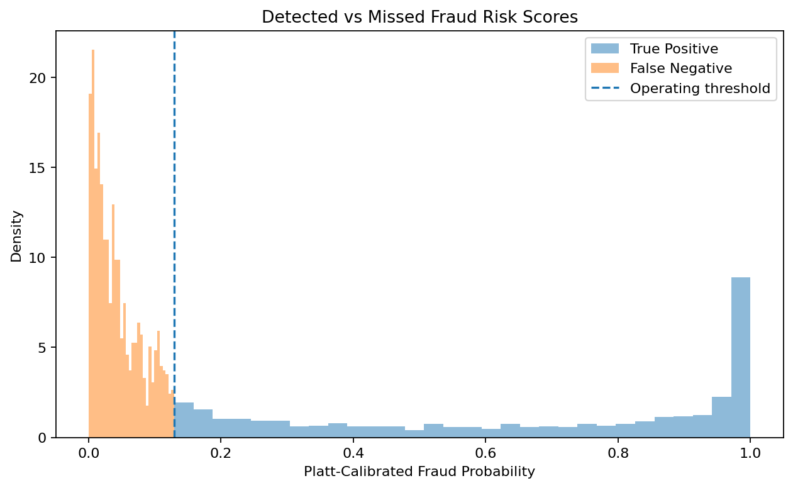

# E-Commerce Fraud Risk Scoring with IEEE-CIS

**Fraud-risk modeling with chronological validation, probability calibration, threshold selection and error analysis.**

This project builds a fraud-risk scoring workflow using the IEEE-CIS Fraud Detection dataset.

The objective is to rank transactions by fraud risk and translate those scores into a practical review policy. The analysis therefore covers not only model performance, but also class imbalance, temporal validation, probability calibration, investigation workload, threshold selection and missed-fraud analysis.

The dataset comes from the Kaggle **IEEE-CIS Fraud Detection** competition and contains anonymized e-commerce transaction and identity data provided by Vesta Corporation.

---

## Key Results

The final LightGBM model was evaluated on a chronologically later holdout covering relative transaction days **155–182**.

| Metric | Final holdout |
|---|---:|
| ROC-AUC | **0.9119** |
| Average precision | **0.5468** |
| Fraud prevalence | **3.53%** |
| Probability threshold | **0.1295** |
| Transactions flagged | **5.67%** |
| Precision | **38.52%** |
| Recall | **61.79%** |
| Fraud enrichment | **10.91×** |

The operating threshold was selected before the final holdout was evaluated.

On the earlier decision-selection period, the same policy produced **38.81% precision** and **61.47% recall**. On the final holdout, precision was **38.52%** and recall **61.79%**.

---

## Project Framing

Although the data come from a Kaggle competition, this is not a leaderboard-oriented solution.

The competition test set is not used. Instead, the labelled training data are treated as a historical transaction stream and split chronologically so that model development uses earlier observations and evaluation uses later ones.

The workflow includes:

- chronological validation;
- leakage-aware preprocessing;
- class-imbalance analysis;
- LightGBM modeling;
- feature-engineering experiments;
- probability calibration;
- review-capacity and cost-sensitivity analysis;
- SHAP and feature-importance analysis;
- final holdout evaluation;
- and error analysis.

---

## Dataset

The project uses:

- `train_transaction.csv`
- `train_identity.csv`

The transaction table contains **590,540 labelled transactions**, of which approximately **3.50%** are fraudulent.

The data present several modeling challenges, including extensive missingness, mixed numeric and categorical variables, high-cardinality categories, anonymized feature groups and identity information available for only a subset of transactions.

Raw competition data are not included in this repository.

See [`data/README.md`](data/README.md) for data-access and Kaggle API instructions.

---

## Chronological Validation

The labelled data cover **182 relative transaction days**.

| Period | Relative days | Purpose |
|---|---:|---|
| Model training | 1–101 | Model fitting |
| Internal validation | 102–127 | Model and feature selection |
| Calibration fit | 128–141 | Probability calibration |
| Decision selection | 142–154 | Threshold and operating-policy selection |
| Final holdout | 155–182 | Final evaluation |

All preprocessing or modeling decisions that require learning from data are restricted to the appropriate historical partition.



---

## Data Audit and Preprocessing

The first notebook covers dataset structure, data quality and validation design.

It includes transaction and identity-table integrity checks, target imbalance, temporal patterns, missingness, feature groups, memory optimization, table integration, categorical handling and unseen-category checks.

A notable result is that identity-data availability is associated with fraud prevalence. Transactions with identity information have a substantially higher observed fraud rate than those without it.

For this reason, missingness is treated as potentially informative rather than only as a preprocessing problem.

---

## Baseline Model

LightGBM was selected for the main model because the dataset is large, high-dimensional and contains substantial missingness and categorical information.

The initial baseline produced:

| Metric | Internal validation |
|---|---:|
| ROC-AUC | **0.9288** |
| Average precision | **0.6466** |
| Fraud prevalence | **4.06%** |

Average precision was about **15.9 times the fraud prevalence** on the internal validation period.

---

## Feature Engineering

Several targeted feature groups were tested:

- time-derived features;
- transaction-amount features;
- email-derived features;
- missingness indicators.

The experiments did not show a consistent improvement over the original feature set.

The final model therefore retains the simpler source-feature representation rather than adding feature engineering that did not provide clear validation benefit.

---

## Model Refinement

A small set of LightGBM refinements was evaluated after the baseline.

| Model | ROC-AUC | Average precision |
|---|---:|---:|
| Original baseline | 0.9288 | 0.6466 |
| PR-aligned baseline | 0.9281 | 0.6515 |
| **Higher capacity** | **0.9321** | **0.6584** |
| Regularized | 0.9277 | 0.6548 |
| Class-weighted | 0.9167 | 0.6134 |

The best validation result came from increasing tree capacity to **63 leaves**.

Class weighting reduced ranking performance and was not retained.



---

## Probability Calibration

The final LightGBM model produces useful ranking scores, but ranking performance does not guarantee well-calibrated probabilities.

Calibration was fitted separately on relative days **128–141**.

Three alternatives were compared:

| Method | Brier score | Log loss |
|---|---:|---:|
| Raw LightGBM | **0.0195** | 0.0812 |
| **Platt scaling** | 0.0196 | **0.0807** |
| Isotonic regression | 0.0198 | 0.0835 |

Platt scaling was selected. The improvement was small, so calibration is treated as a probability adjustment rather than a major model-performance gain.



---

## Operating Threshold

The calibrated score must be converted into a review decision.

Thresholds were evaluated on the decision-selection period using precision, recall and the percentage of transactions sent for review.



### Review-capacity scenarios

| Review capacity | Precision | Recall | Fraud enrichment |
|---:|---:|---:|---:|
| 1% | 90.81% | 28.77% | 28.76× |
| 2% | 69.05% | 43.75% | 21.87× |
| **5%** | **38.81%** | **61.47%** | **12.29×** |
| 10% | 23.54% | 74.57% | 7.46× |

A **5% review capacity** was used as the main operating scenario.

This corresponds to a calibrated probability threshold of **0.1295**.



---

## Cost Sensitivity

The threshold analysis was also repeated under illustrative false-negative-to-false-positive cost ratios.

| FN:FP cost ratio | Alert rate | Recall |
|---:|---:|---:|
| 20:1 | 11.0% | 76.5% |
| 50:1 | 22.4% | 86.3% |
| 100:1 | 31.6% | 91.4% |

Higher assumed costs for missed fraud lead to lower thresholds and larger review queues.

These ratios are sensitivity assumptions only. They are not estimates of Vesta Corporation's actual fraud costs.

---

## Final Holdout

After model selection, calibration and threshold selection were complete, the system was evaluated once on relative days **155–182**.

The final holdout results were:

| Metric | Result |
|---|---:|
| ROC-AUC | **0.9119** |
| Average precision | **0.5468** |
| Precision | **38.52%** |
| Recall | **61.79%** |
| Alert rate | **5.67%** |
| Fraud enrichment | **10.91×** |

The operating results were close to those observed during decision selection, despite the later time period.

---

## Explainability

Model behavior was examined using both LightGBM gain importance and SHAP.

### LightGBM gain importance



### SHAP importance



Features appearing prominently across the two analyses include:

- `TransactionAmt`
- `C13`
- `C14`
- `C1`
- `card2`
- `TransactionDT`
- `D2`
- `card1`
- `V294`
- email-domain variables
- identity and browser information

Because many IEEE-CIS variables are anonymized, these results are interpreted as measures of model reliance rather than causal effects.

---

## Error Analysis

The final holdout was also used to compare detected and missed fraud.

Fraud recall differs substantially depending on whether identity information is available:

| Identity record | Fraud recall |
|---|---:|
| Available | **77.57%** |
| Not available | **40.81%** |

Recall also varies across `ProductCD`:

| ProductCD | Fraud recall |
|---|---:|
| R | 84.77% |
| C | 79.63% |
| H | 68.38% |
| S | 57.60% |
| W | 40.02% |

The `W` group is particularly relevant because it contains more than one thousand fraudulent transactions in the holdout.

Missed fraud also tends to contain less identity information and higher overall missingness than detected fraud.



These results are reported as limitations and monitoring signals. They were not used to retune the model after the final holdout was opened.

---

## Notebooks

| Notebook | Contents |
|---|---|
| [`01_data_audit_preprocessing`](notebooks/ecommerce_fraud_risk_ieee_cis_01_data_audit_preprocessing.ipynb) | Data ingestion, structural audit, missingness, temporal analysis, preprocessing and chronological split design |
| [`02_feature_engineering_modeling`](notebooks/ecommerce_fraud_risk_ieee_cis_02_feature_engineering_modeling.ipynb) | Baseline modeling, feature-engineering experiments and LightGBM refinement |
| [`03_calibration_explainability_business`](notebooks/ecommerce_fraud_risk_ieee_cis_03_calibration_explainability_business.ipynb) | Calibration, threshold selection, cost sensitivity, final holdout evaluation, explainability and error analysis |

The notebooks are intended to be read in order.

---

## Repository Structure

```text
ecommerce-fraud-risk-ieee-cis/
│
├── data/
│   ├── README.md
│   └── raw/
│       └── .gitkeep
│
├── notebooks/
│   ├── ecommerce_fraud_risk_ieee_cis_01_data_audit_preprocessing.ipynb
│   ├── ecommerce_fraud_risk_ieee_cis_02_feature_engineering_modeling.ipynb
│   └── ecommerce_fraud_risk_ieee_cis_03_calibration_explainability_business.ipynb
│
├── reports/
│   ├── figures/
│   └── tables/
│
├── .gitignore
├── LICENSE
├── README.md
└── requirements.txt
```

The `reports/` directory contains selected figures and CSV summaries generated by the notebooks.

---

## Reproduction

The notebooks were validated in **Google Colab with Python 3.13.16**.

### Clone the repository

```bash
git clone https://github.com/apostolis-bloutsos-data/ecommerce-fraud-risk-ieee-cis.git
cd ecommerce-fraud-risk-ieee-cis
```

### Kaggle access

The IEEE-CIS competition data are not distributed with this repository.

To reproduce the analysis:

1. Sign in to Kaggle.
2. Accept the IEEE-CIS Fraud Detection competition rules.
3. Create a Kaggle API token.
4. Add the token to Google Colab Secrets as `KAGGLE_API_TOKEN`.
5. Grant the notebook access to the secret.
6. Run the notebooks in order.

The notebooks download the required training files through the Kaggle CLI.

The API token is read from Colab Secrets and is not stored in the notebooks or repository.

See [`data/README.md`](data/README.md) for further details.

### Dependencies

```bash
pip install -r requirements.txt
```

The notebooks are primarily designed to run in Google Colab.

---

## Tools

Python · pandas · NumPy · LightGBM · scikit-learn · SHAP · Matplotlib · Kaggle API · Google Colab

---

## Limitations

- Many IEEE-CIS variables are anonymized, which limits business interpretation.
- The 5% review capacity is an illustrative operating assumption rather than a known operational constraint.
- Cost ratios are sensitivity assumptions rather than measured financial costs.
- Performance is evaluated on one historical dataset.
- The repository demonstrates an analytical fraud-risk workflow, not a deployed production service.
- Online inference, drift monitoring and automated retraining are outside the project scope.

---

## Possible Extensions

Further work could include walk-forward validation, drift monitoring, subgroup-specific operating policies, calibration monitoring, model serving and automated data-quality checks.

These extensions were left outside the current scope.

---

## License

Project code and documentation are released under the [MIT License](LICENSE).

The IEEE-CIS dataset is not covered by this license and remains subject to the Kaggle competition terms.